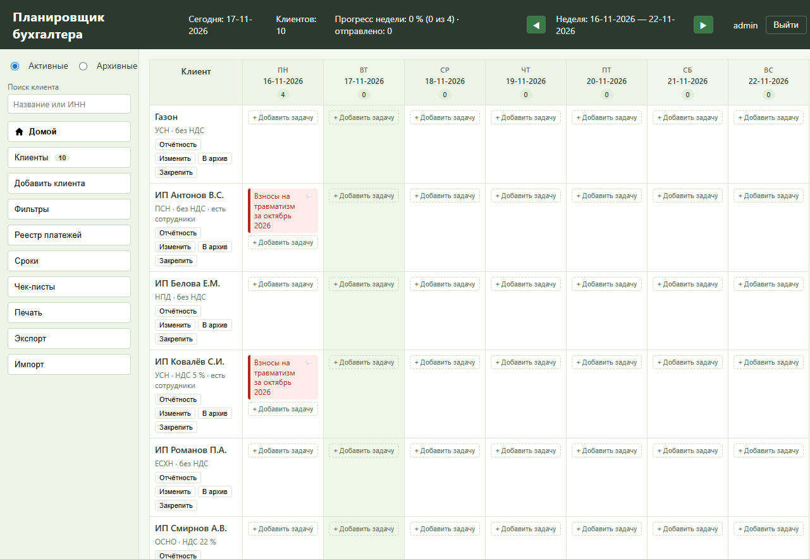
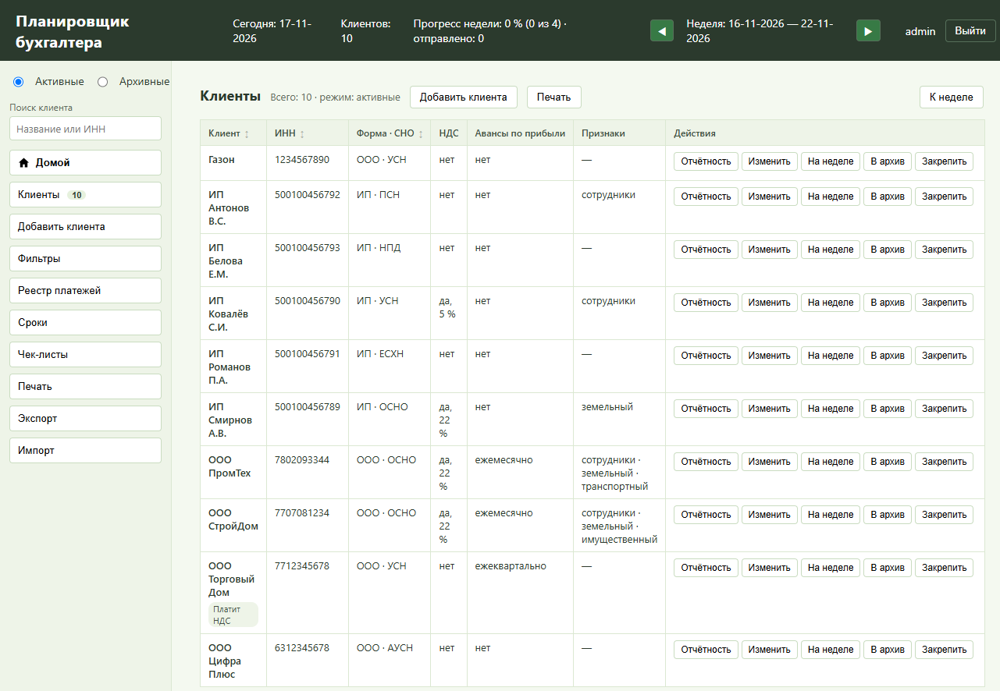
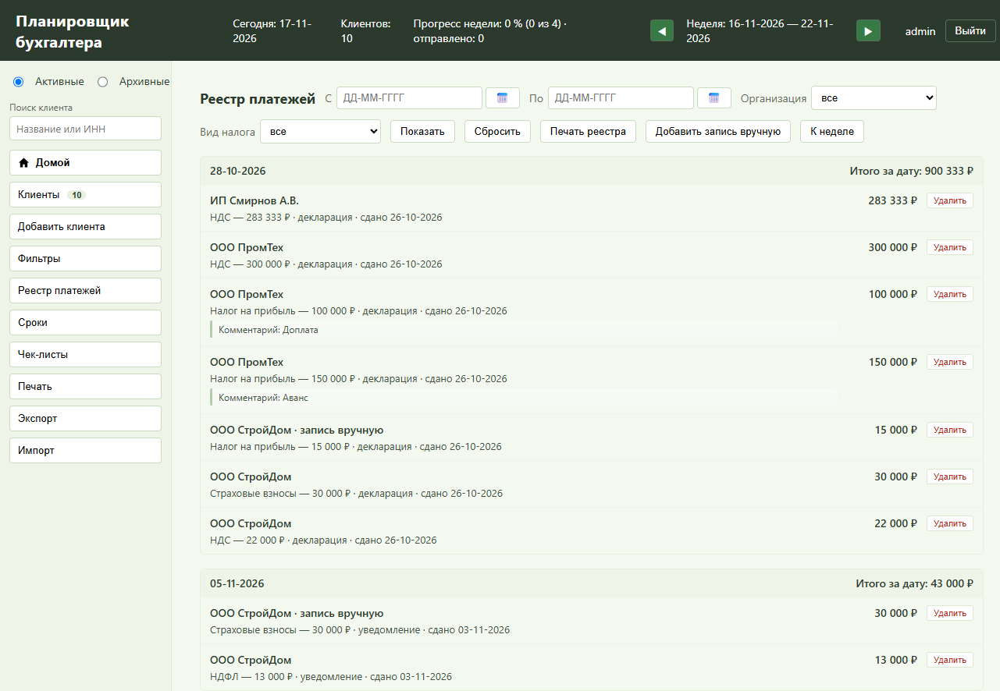

# Планировщик бухгалтера (asbuhg-planner)

Серверное веб-приложение для бухгалтера, который ведёт небольшую практику: клиенты — ИП и ООО, десятки сроков отчётности и уплаты налогов в году. Приложение само строит календарь сроков по карточке клиента, показывает задачи сеткой «клиенты × дни недели», ведёт реестр налоговых платежей и печатает формы.

Это портфолио-версия проекта: в репозитории только код приложения, служебные данные шаблона календаря и презентационные материалы. Рабочие документы, исходные выгрузки и база данных не публикуются.



## Задача

Бухгалтеру нужно одновременно отслеживать сроки по нескольким клиентам с разными системами налогообложения. Источники сроков разрозненны, правила зависят от формы клиента, наличия сотрудников и налоговых признаков, а переносы с выходных считаются вручную. Ошибка в дате означает просроченную отчётность или платеж.

Решение: правила описаны данными и вынесены в отдельный модуль, производственный календарь хранится отдельным файлом, а сервер генерирует задачи и проверяет их на дубликаты. Бухгалтер видит неделю целиком и работает со статусами, а суммы налогов живут в реестре платежей.

## Возможности

### Клиенты и недельная сетка

- Карточка клиента: форма (ООО/ИП), ИНН, система налогообложения, ставка НДС, авансы по прибыли, признаки земельного, имущественного и транспортного налогов, наличие сотрудников, освобождение от НДС, дополнительные флаги.
- Проверка полей при сохранении: ИНН 10 цифр для ООО и 12 для ИП, только цифры, обязательные поля не остаются пустыми.
- Сетка недели: строки — клиенты, столбцы — дни, счётчик задач в шапке каждого дня и прогресс недели.
- Статусы задачи: «сделано», «в работе», «отправлено»; комментарии, ручные задачи и задачи из каталога шаблонов.
- Поиск клиента по названию или ИНН, режимы «Активные / Архивные», закрепление и сортировка клиентов.
- Печать недели и справочника клиентов.



### Календарь сроков и генерация задач

- Генератор строит задачи отчётности и уплаты налогов по правилам: НДС, налог на прибыль, НДФЛ (уведомления и платежи), страховые взносы, УСН/ЕСХН, земельный и имущественный налоги, персональные сведения, РСВ, ЕФС-1, 6-НДФЛ, годовая бухгалтерская отчётность для ООО.
- Условия применимости зависят от карточки клиента: ПСН и НПД не получают налоговых деклараций, но отчётность по сотрудникам применяется к ним на общих основаниях.
- Все сроки переносятся на ближайший рабочий день по производственному календарю. Горизонт генерации в демо-конфигурации: 01.10.2026 — 30.04.2027.
- Повторная генерация идемпотентна: уже созданные задачи не дублируются.
- Раздел «Сроки» показывает справочник правил только для чтения и календарь нерабочих дней с нормой рабочих/выходных дней по месяцам.
- Календарь можно обновить вручную с двух согласованных сайтов: данные применяются только после сверки источников и проверки; при расхождении показывается предупреждение. Предусмотрена сверка расчётных сроков с календарём источника.
- Шаблон календаря (`resources/calendar-template.json`) скачивается из интерфейса; заполненный файл загружается с предпросмотром изменений и подтверждением. Год добавляется в календарь без изменения кода.

### Реестр платежей

- Суммы хранятся только в реестре, в задаче нет сумм — только состав уведомления (`taxLines`) и признак внесения платежа.
- Заполнение реестра из задачи-уведомления или декларации с предзаполненным источником суммы и расшифровкой по налогам.
- Деление квартального НДС на три равные доли с остатком в последней; повторное заполнение требует подтверждения.
- Ежемесячные авансы по налогу на прибыль, взносы на травматизм и транспортный налог как ручные записи.
- Фильтры по клиенту, дате и виду налога; комментарии к записям.



### Надёжность и доступ

- Одна учётная запись бухгалтера, вход по логину и паролю, сессия в `HttpOnly`-cookie с таймаутом бездействия. Пароль хранится хешем scrypt; смена пароля закрывает все сессии.
- Экспорт и импорт бизнес-данных в JSON с валидацией файла и предпросмотром перед заменой.
- Восстановление после повреждения базы: загрузить копию или начать с нуля. Повреждённый файл сохраняется рядом.
- Всё изменение данных выполняется в транзакциях SQLite; схема ведётся миграциями.
- Внешние библиотеки, CDN, аналитика и передача данных третьим лицам не используются.

## Технологии

| Слой | Решение |
| --- | --- |
| Сервер | Node.js ≥ 22.5, только встроенные модули; HTTP-сервер и собственный JSON API |
| Хранилище | SQLite через `node:sqlite`, режим WAL, миграции в `server/migrations/` |
| Фронтенд | Чистые HTML, CSS и JavaScript без сборки и зависимостей |
| Безопасность | scrypt для пароля, сессионные cookie `HttpOnly` + `SameSite=Strict`, таймаут бездействия |
| Календарь | Отдельный JSON-файл с производственным календарём; правила чтения и проверки в `server/calendar.js` |

Сервер отдаёт статику из `app/` и обрабатывает `/api/*`. Браузер не хранит бизнес-данные: клиенты, задачи, платежи, шаблоны и настройки живут в базе SQLite.

## Быстрый старт

Потребуется Node.js версии 22.5 или новее (модуль `node:sqlite`). Установка зависимостей не нужна.

```bash
git clone https://github.com/Olleva/asbuhg-planner.git
cd asbuhg-planner
npm start
```

При первом запуске сервер создаст единственную учётную запись `admin` и напечатает сгенерированный пароль в консоли — его нужно сохранить, он показывается только один раз. Откройте `http://127.0.0.1:3000`, войдите и при желании загрузите демонстрационные данные:

```bash
npm run demo
```

Пароль можно задать заранее через `ASBUHG_PASSWORD` или сменить позже:

```bash
npm run password -- НовыйПароль123
```

### Переменные окружения

| Переменная | По умолчанию | Назначение |
| --- | --- | --- |
| `ASBUHG_HOST` | `127.0.0.1` | Адрес, который слушает сервер |
| `ASBUHG_PORT` | `3000` | Порт HTTP-сервера |
| `ASBUHG_DATA_DIR` | `<корень>/data` | Каталог базы, календаря и настроек источников |
| `ASBUHG_SESSION_MIN` | `480` | Таймаут сессии в минутах |
| `ASBUHG_LOGIN` | `admin` | Логин единственной учётной записи при первом запуске |
| `ASBUHG_PASSWORD` | генерируется | Пароль при первом запуске |

### Команды

| Команда | Что делает |
| --- | --- |
| `npm start` | Запустить сервер приложения |
| `npm run demo` | Добавить демонстрационных клиентов из набора проекта |
| `npm run demo:reset` | Пересоздать демонстрационных клиентов |
| `npm run password -- <пароль>` | Сменить пароль и закрыть все сессии |
| `npm run dates` | Проверить календарь и функции расчёта дат |
| `npm run check` | Проверить синтаксис всех JavaScript-файлов |

## Структура репозитория

```text
.
├── app/                       # Клиентская часть: статическая раздача сервером
│   ├── index.html
│   ├── styles.css
│   └── app.js
├── server/                    # Серверные модули и JSON API
│   ├── index.js               # Точка входа, маршруты API и статика
│   ├── config.js
│   ├── db.js
│   ├── auth.js
│   ├── calendar.js            # Загрузка и проверка календаря нерабочих дней
│   ├── calendar-sources.js    # Чтение календаря с согласованных сайтов
│   ├── calendar-update.js     # Сверка источников и применение календаря
│   ├── reporting-check.js     # Сверка сроков с календарём источника
│   ├── rules.js               # Правила генерации задач (чистая логика)
│   ├── clients.js, tasks.js, payments.js, templates.js, checklists.js
│   ├── reference.js, search.js, settings.js, backup.js, recovery.js
│   ├── dates.js               # Форматы и расчёт дат
│   └── migrations/            # Версионирование схемы SQLite
├── scripts/                   # Консольные утилиты
│   ├── check-dates.js
│   ├── seed-demo.js
│   └── set-password.js
├── resources/
│   └── calendar-template.json # Шаблон календаря с пояснениями
├── docs/
│   ├── case.html              # Презентационный кейс проекта
│   ├── style.css
│   └── screenshots/           # Снимки интерфейса для README и кейса
├── package.json
├── README.md
└── LICENSE
```

## Модель данных

Основные таблицы SQLite: `clients`, `client_flags`, `tasks`, `task_tax_lines`, `payments`, `payment_lines`, `templates`, `checklists`, `checklist_items`, `app_settings`, `accounts`, `sessions`, `calendar_updates`, `schema_migrations`. Даты хранятся в ISO 8601 (`YYYY-MM-DD`), суммы — целыми рублями, вложенные списки вынесены в отдельные таблицы. Учётная запись и сессии в экспорт не входят.

Файл календаря живёт отдельно от базы: это позволяет добавлять годы, не меняя код правил. Ключи верхнего уровня, начинающиеся с `_`, служебные и при загрузке игнорируются.

## Ветки

- `main` — стабильная версия, то, что попадает в портфолио и рекомендуется к запуску.
- `develop` — интеграционная ветка для следующих изменений.

## Презентация

Презентационный кейс с описанием задачи, решения и результата: [docs/case.html](docs/case.html). Интерфейс рассчитан на рабочий стол: минимальная поддерживаемая ширина окна — 1280 px, мобильная версия не предусмотрена.

## Ограничения

- Приложение не передаёт отчётность в ФНС, СФР или банки; это не система электронной отчётности.
- Предусмотрена одна учётная запись: ролей, регистрации и совместного доступа нет.
- Обновление календаря выполняется только вручную; без интернета приложение работает на сохранённом календаре.
- Горизонт генерации сроков в текущей конфигурации ограничен 2026–2027 годами.

## Лицензия

MIT — см. [LICENSE](LICENSE).
